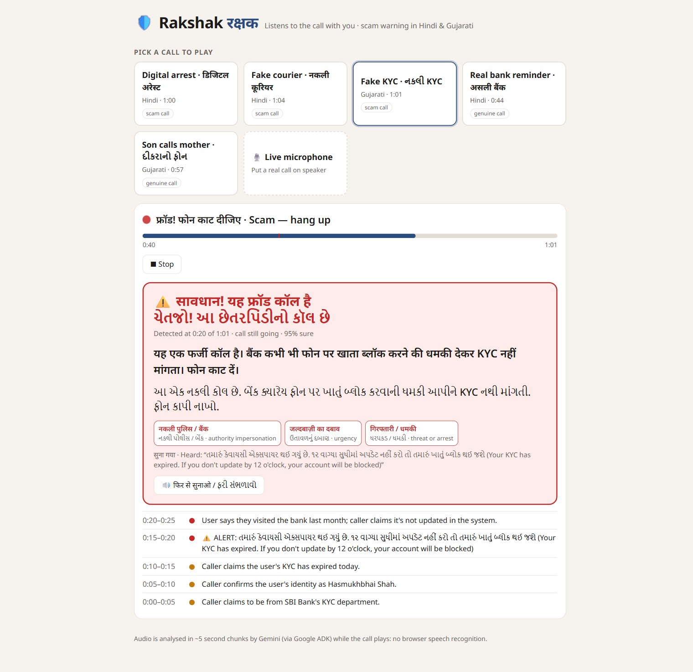

# 🛡️ Rakshak (रक्षक): a scam-call guardian that listens with you

"Digital arrest", fake-KYC and fake-courier calls cost Indians thousands of crores a
year. Elders and first-time smartphone users are hit hardest, and the scam works
because the victim is **alone on the call**.

Rakshak is a voice agent built with **Google ADK** (scaffolded with **agents-cli**). It
listens to a call in ~5 second audio chunks and raises an alert **while the call is
still going**. The alert names the red flags it heard and explains them in simple
Hindi and Gujarati, both on screen and spoken aloud:

> ⚠️ सावधान! यह फ्रॉड कॉल है: "पुलिस कभी वीडियो कॉल पर गिरफ्तार नहीं करती। फोन तुरंत काट दीजिए।"
> red flags: नकली पुलिस (authority_impersonation) · गिरफ्तारी / धमकी (threat_or_arrest) · …

It stays quiet on genuine calls, including ones that mention *bank*, *KYC* and *OTP*.



## How it works

```
call audio ─► 5 s chunks (16 kHz PCM) ─► ADK Runner, one session per call
                                          │ each chunk = one user turn: "[CALL CHUNK n | t0-t1]" + audio/wav
                                          ▼
              rakshak agent (gemini-3.8-flash, native audio understanding, no browser speech API)
              exactly one tool per chunk:
                • log_call_status(risk_level, heard)          → timeline
                • raise_scam_alert(scam_type, red_flags[], confidence,
                                   warning_hindi, warning_gujarati, evidence)  → alert (once per call)
                                          ▼
              web UI: red banner + red-flag chips + spoken warning (Gemini TTS)
```

* **End-to-end audio model.** Gemini hears the raw call audio, colloquial Hindi and
  Gujarati included. There is no separate ASR and no Web Speech API.
* **Mid-call.** The session keeps every earlier chunk, so the agent judges the
  *whole call so far*. If the model ever falls behind real time, the chunks heard in
  the meantime are merged into the next turn, so it always catches up to "now"
  (`rakshak/monitor.py`).
* **Low latency.** The tools set `skip_summarization`, so each chunk costs one model
  round-trip. An `after_agent_callback` writes the final text from state.
* **Red-flag catalogue** (`rakshak/tools.py`): `urgency`, `threat_or_arrest`,
  `otp_request`, `money_transfer`, `authority_impersonation`, `secrecy_isolation`,
  `remote_app_install`, `personal_data_request`.

## Demo calls (`data/calls/*.wav`)

| Call | Language | Kind | Expected |
|---|---|---|---|
| `digital_arrest_hi` | Hindi | fake "Cyber Crime / CBI" officer, video-call custody, "RBI safe account" | alert |
| `fake_kyc_gu` | Gujarati | fake SBI KYC expiry, AnyDesk, OTP | alert |
| `fake_courier_hi` | Hindi | FedEx parcel with drugs → "Mumbai police" → UPI "clearance fee" | alert |
| `genuine_gu` | Gujarati | son reminds mother about the doctor, KYC at branch, "never share OTP" | **no alert** |
| `genuine_bank_hi` | Hindi | real bank RM: FD maturing, visit branch, "bank never asks OTP" | **no alert** |

The calls are scripted in `data/scripts/*.json` and rendered line by line with Gemini
multi-voice TTS, then band-limited to sound like a phone line
(`scripts/generate_calls.py`). Per-line timings (`*.timing.json`) are the ground truth
for *when* each scam becomes evident (`alert_line`).

## Run it

```bash
uv tool install google-agents-cli     # once
agents-cli install                    # project deps (uv sync)
uv sync --extra eval                  # + ADK eval deps
cp .env.example .env                  # add GOOGLE_API_KEY (or use Vertex ADC, see file)

# Web demo: pick a call, watch the alert appear mid-call; or use the live microphone
uv run uvicorn rakshak.server:app --port 8080      # → http://localhost:8080

# Terminal demo (add --play to hear the call on Windows)
uv run python -m rakshak.demo data/calls/digital_arrest_hi.wav --realtime

# ADK dev UI / agents-cli playground
agents-cli playground
```

The **🎙️ Live microphone** mode streams 16 kHz PCM from the browser over a WebSocket
(`/ws/listen`). Put a real call on speaker next to the laptop.

## Tests and evals

| Layer | Command | What it checks |
|---|---|---|
| Unit (offline) | `uv run pytest` | chunking/resampling, tools & dedupe, monitor (fake runner: mid-call alert, lag merging), callbacks, server routes + WebSocket |
| Live audio E2E | `uv run pytest -m live tests/integration/test_live_calls.py` | every scam .wav is flagged **after** the scam is audible and **≥10 s before the call ends**, with `authority_impersonation` + ≥2 expected flags, Hindi in Devanagari and Gujarati script; genuine calls never alert |
| ADK evals | `uv run pytest -m live tests/integration/test_adk_evals.py` | `AgentEvaluator` on 4 evalsets (transcript + real audio, scam + genuine): per-chunk `tool_trajectory_avg_score` (EXACT, scam ≥ 0.75, genuine = 1.0, so one false alarm fails) and `rubric_based_tool_use_quality_v1` for warning language, brevity and flags |
| agents-cli eval | `agents-cli eval run --dataset tests/eval/datasets/rakshak-dataset.json --config tests/eval/eval_config.yaml` | `scam_decision` (alert vs. log at greeting / evident point / genuine) and `warning_quality` (LLM judge, 1–5) |
| Server E2E | `E2E_PORT=8077 uv run pytest -m live tests/integration/test_server_e2e.py` | scaffolded ADK `/run_sse`, A2A stream and agent card |

You can also run the ADK eval CLI directly:

```bash
adk eval rakshak rakshak/evals/transcript/scam/scam_calls_transcript.test.json \
  --config_file_path rakshak/evals/transcript/scam/test_config.json --print_detailed_results
```

Evalsets are generated from the scripts and audio: `python scripts/build_evalsets.py`
(the audio evalsets, ~11 MB, are git-ignored and rebuilt by this command).

## Layout

```
rakshak/agent.py       ADK agent: instruction, tools, chunk callbacks
rakshak/tools.py       raise_scam_alert / log_call_status + red-flag catalogue
rakshak/monitor.py     LiveCall / CallMonitor: chunk → ADK turn → events (real-time pacing)
rakshak/audio.py       wav load/resample, phone-line filter, chunking
rakshak/server.py      FastAPI demo (SSE replay, mic WebSocket, /api/speak TTS)
rakshak/static/        single-page UI
rakshak/evals/         ADK evalsets + test_config.json
rakshak/fast_api_app.py  agents-cli scaffold server (ADK web + A2A)
data/scripts, data/calls   call scripts, rendered .wav + timings
scripts/               generate_calls.py, build_evalsets.py
tests/unit, tests/integration, tests/eval (agents-cli)
```
